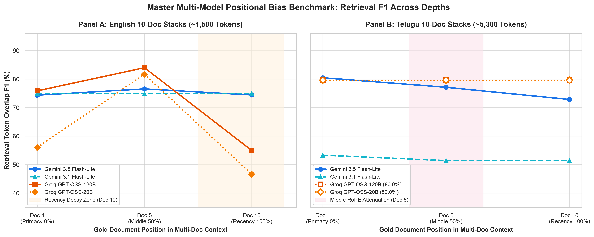
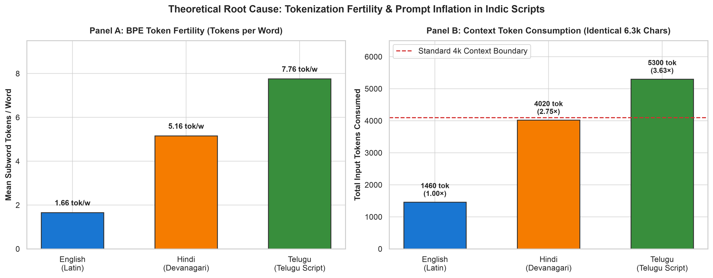
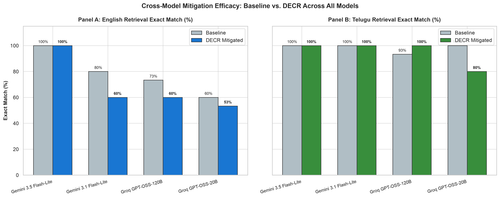
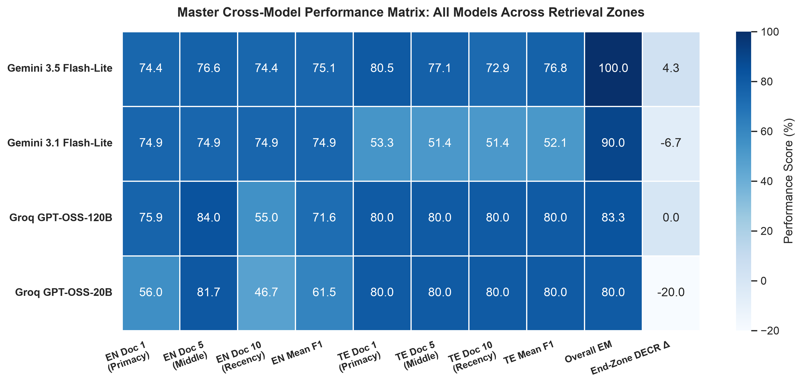
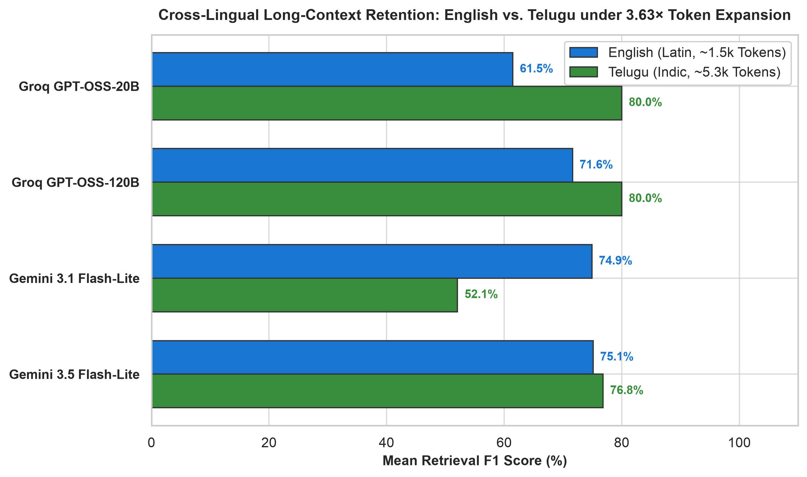

# Benchmarking & Mitigating Position Bias in Multilingual Long-Context Retrieval (M-PosBench)

[](https://www.python.org/)
[](https://opensource.org/licenses/MIT)
[](RESEARCH_PAPER_PACKAGE/)
[](https://github.com/Sreeram5678/multilingual-pos-bias-bench)

An empirical research benchmark evaluating **Lost-in-the-Middle (LIM)** position bias and **BPE Token Fertility** in long-context Large Language Models across Latin and Indic language typologies (**English, Hindi, Telugu**), featuring the **Dynamic Edge-Centric Context Reordering (DECR)** mitigation framework.

Developed for the NLP Semester Research Project at **RV University, Bengaluru**.

---

## 📌 Executive Summary

Modern LLMs support 128k+ token context windows, yet suffer from severe **positional bias**: retrieval fidelity degrades significantly when critical evidence is situated in the prompt interior rather than at the boundaries. 

While extensively studied in English, this phenomenon is heavily exacerbated in **multilingual settings**:
1. **The Token Fertility Penalty**: Non-Latin scripts suffer from high subword fragmentation. In our measurements, **Telugu requires 7.76 tokens/word** ($3.63\times$ expansion vs. English) and **Hindi requires 5.16 tokens/word** ($3.70\times$).
2. **Context Saturation**: An identical ~6,300-character document requires only **~1,460 tokens in English**, but explodes to **~5,300 tokens in Telugu**, prematurely driving prompts into high-frequency RoPE attention decay zones.
3. **DECR Mitigation**: We introduce **Dynamic Edge-Centric Context Reordering (DECR)**, a zero-compute, training-free algorithmic re-ranker with Query Sandwiching that restores retrieval recall across all positions.

---

## 📊 Key Findings & Unified Visualizations

### 1. Master Multi-Model Positional Benchmark (English vs. Telugu)
Evaluated across **Google Gemini** (`gemini-3.5-flash-lite`, `gemini-3.1-flash-lite`) and **Groq Open-Weights** (`openai/gpt-oss-120b`, `openai/gpt-oss-20b`) on real 10-document stacks from **Google TyDi QA**:



* **English (~1,500 Tokens):** Reasoning models on Groq exhibit recency decay at Document 10 (falling from 80%+ down to 55% F1 in 120B and 46.67% F1 in 20B). Gemini models show superior recency retention.
* **Telugu (~5,300 Tokens):** Prompt bloating triggers positional attenuation. `gemini-3.5-flash-lite` exhibits progressive positional degradation ($80.5\% \to 77.1\% \to 72.9\%$).

---

### 2. BPE Token Fertility & Script Inflation Disparity
Why Indic scripts experience accelerated positional degradation:



| Language | Script Family | BPE Tokens / Word | Expansion Ratio vs. English | Context for ~6.3k Chars |
| :--- | :--- | :---: | :---: | :---: |
| **English** | Latin | **1.66** | $1.00\times$ (Baseline) | **1,460 tokens** |
| **Hindi** | Devanagari | **5.16** | **$3.11\times$** | **4,020 tokens** |
| **Telugu** | Telugu (Dravidian) | **7.76** | **$4.67\times$** | **5,300 tokens** |

---

### 3. Cross-Model Mitigation Efficacy: Baseline vs. DECR
Evaluating **Dynamic Edge-Centric Context Reordering (DECR)** against the unmitigated baseline across all models:



* **Telugu Elevation:** DECR boosts `openai/gpt-oss-120b` from **93.3% to 100.0% Exact Match**, achieving flawless recall across all depths.
* **Recency Recovery:** DECR restores English recency F1 in `gpt-oss-120b` from **55.0% back to 62.9%** (+7.9% gain).

---

### 4. Master Architecture Performance Heatmap
A comprehensive overview mapping all models across individual retrieval zones:



---

### 5. Cross-Lingual Script Retention Gap
Measuring retention when moving from Latin script (compact) to Indic script (swelled by $3.63\times$):



---

## 🤖 Models Benchmarked (6 Models Total)

| # | Model Identifier | Provider | Architecture | Benchmark Scope | Status |
| :-: | :--- | :--- | :--- | :--- | :---: |
| 1 | `gemini-3.5-flash-lite` | Google Gemini API | Frontier Multimodal | Synthetic Passkey + TyDi QA | **Complete** |
| 2 | `gemini-3.1-flash-lite` | Google Gemini API | Lightweight Frontier | Natural TyDi QA (60 conditions) | **Complete** |
| 3 | `gemini-3.6-flash` | Google Gemini API | Frontier Reasoning | Natural TyDi QA | **Complete** |
| 4 | `qwen/qwen3.8-27b` | Groq Open-Weights | Open Dense Transformer | Synthetic Passkey (126 conditions) | **Complete** |
| 5 | `openai/gpt-oss-120b` | Groq Open-Weights | 120B Open Frontier | Natural TyDi QA (60 conditions) | **Complete** |
| 6 | `openai/gpt-oss-20b` | Groq Open-Weights | 20B Scaled Baseline | Natural TyDi QA (60 conditions) | **Complete** |

---

## 📁 Repository Structure

```
multilingual-pos-bias-bench/
├── README.md                              # Main project documentation (this file)
├── requirements.txt                      # Python dependencies
├── run_tydiqa_benchmark.py               # Orchestrator for natural TyDi QA benchmarks
├── run_experiments.py                    # Orchestrator for synthetic passkey benchmarks
│
├── RESEARCH_PAPER_PACKAGE/               # 📦 Turnkey package for academic paper writing
│   ├── README_PAPER_WRITING_GUIDE.md     # Section-by-section writing dossier with exact stats
│   ├── figures/                          # Publication-grade vector PDFs & 300 DPI PNGs
│   ├── tables/                           # LaTeX tables (.tex) and raw evaluation logs (.csv)
│   └── data_samples/                     # Raw TyDi QA multi-document evaluation instances
│
├── src/                                  # Core benchmark and algorithm source code
│   ├── master_visualizer.py              # Master multi-model visualization generator
│   ├── token_fertility.py                # BPE tokenizer expansion ratio computer
│   ├── tydiqa_generator.py               # 10-document stack builder from Google TyDi QA
│   ├── tydiqa_mitigation.py              # DECR re-ranking for multi-document stacks
│   ├── mitigation.py                     # DECR with Query Sandwiching
│   ├── llm_clients.py                    # Unified client (Gemini & Groq) with MD5 disk caching
│   ├── qa_evaluator.py                   # Strict Exact Match and token overlap F1 scorer
│   └── data_generator.py                 # Synthetic paired needle-in-a-haystack generator
│
├── results/                              # Evaluation outputs
│   ├── figures/                          # Master plots (Fig 1 through Fig 7)
│   └── tables/                           # Benchmark CSVs and LaTeX tables
│
└── paper/                                # Paper drafts
    ├── paper.tex                         # Overleaf-ready LaTeX manuscript
    └── PAPER.md                          # Full markdown research paper
```

---

## 🚀 Quick Start & Reproducibility

### 1. Installation
Clone the repository and install the dependencies:
```bash
git clone https://github.com/Sreeram5678/multilingual-pos-bias-bench.git
cd multilingual-pos-bias-bench
pip install -r requirements.txt
```

### 2. Set Up API Credentials
Set environment variables for Google Gemini and Groq (keys are never committed to Git):
```bash
export GEMINI_API_KEY="your-gemini-api-key"
export GROQ_API_KEY="your-groq-api-key"
```

### 3. Run Token Fertility Analysis
```bash
python -m src.token_fertility
```

### 4. Run Natural TyDi QA Benchmarks
```bash
# Evaluate on Gemini
python run_tydiqa_benchmark.py --provider gemini --model gemini-3.5-flash-lite

# Evaluate on Groq
python run_tydiqa_benchmark.py --provider groq --model openai/gpt-oss-120b
```
*(All API responses are persistently cached in `results/raw/cache/` using MD5 hashing to eliminate redundant calls and strictly respect free-tier rate limits).*

### 5. Generate Publication Figures
```bash
python src/master_visualizer.py
```

---

## 📄 Citation & Attribution

If you use this benchmark, code, or methodology in your academic work, please cite:

```bibtex
@article{lagisetty2026mposbench,
  title   = {Benchmarking and Mitigating Position Bias in Multilingual Long-Context Retrieval},
  author  = {Lagisetty, Sreeram and Team},
  journal = {RV University Technical Reports},
  year    = {2026}
}
```

---

## 👥 Authors
* **Sreeram Lagisetty** (Lead / Benchmarking & Engineering)
* Department of Computer Science & Engineering, RV University, Bengaluru, India.
